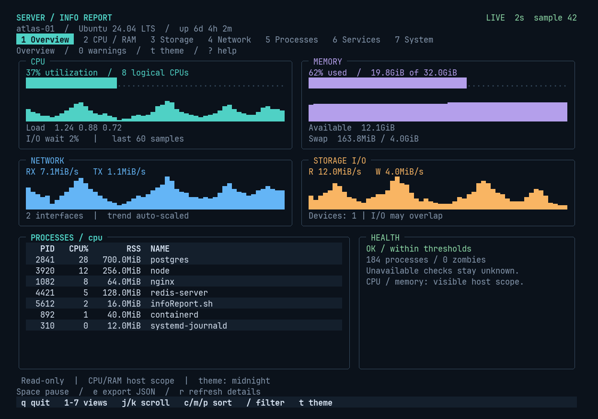

# ServerInfoReport

A live Linux monitoring TUI and report generator in **one Bash script**. Copy
`infoReport.sh` to a server and run it. No Python runtime, pip packages, jq, bc,
dialog, configuration file, agent, or web service is required.

```bash
chmod +x infoReport.sh
./infoReport.sh
```

An interactive terminal opens the dashboard. Redirected output produces a plain
text snapshot. Use `--report` to request a snapshot explicitly.

## Dashboard



Preview rendered from the actual Bash TUI with sample data at 120 x 36.
The overview uses six panels with resource colors, history charts, meters,
striped process rows, and a health summary. It fits an 80 x 24 terminal and
switches to a scrollable view below that size.
[See the 80 x 24 layout](docs/compact.png).

Seven scrollable views share one sampled dataset:

| Key | View | Information |
| --- | --- | --- |
| `1` | Overview | Resource bars, 60-sample trends, current threshold alerts, top processes |
| `2` | CPU / RAM | Per-core utilization and I/O wait, load, available memory, swap, PSI pressure, temperatures |
| `3` | Storage | Local filesystem capacity and inode usage, device read/write rates, busy time, inflight I/O |
| `4` | Network | Per-interface RX/TX rates, counters, state, addresses, listening TCP/UDP sockets |
| `5` | Processes | Interval CPU utilization, RSS, state, CPU/memory/PID sorting, name/PID filter |
| `6` | Services | systemd or OpenRC service states, optional local Docker/Podman containers |
| `7` | System | Distribution, kernel, architecture, init, virtualization, package manager, cgroup limits, capabilities |

`Tab` / left / right change views. `j` / `k`, arrows, Page Up / Page Down,
Home / End scroll. `Space` pauses. `c` / `m` / `p` sort processes; `/` filters
them. `r` requests updated details. `e` saves the current snapshot as JSON.
`t` cycles themes. `?` opens help; `q` or Escape exits.

```bash
./infoReport.sh --theme midnight  # teal / violet / blue / amber on dark slate
./infoReport.sh --theme nord      # muted Arctic palette
./infoReport.sh --theme light     # light background with dark text
./infoReport.sh --ascii           # plain borders and graphs for limited fonts
./infoReport.sh --no-color        # preserve the terminal's default colors
```

Colors adapt to truecolor, 256-color, and basic ANSI terminals. UTF-8 locales
enable rounded borders and block graphs; other locales and the Linux console
use ASCII. Frames are buffered to avoid clearing the screen between updates.
The visual references were [btop](https://github.com/aristocratos/btop) for
resource panels and graphs, and [Glances](https://glances.readthedocs.io/en/latest/quickstart.html)
for compact monitoring information. The renderer is implemented directly in this
script; neither program is a dependency.

The dashboard uses an alternate screen and restores terminal settings on exit,
Ctrl+C, SIGHUP, and SIGTERM. It adapts to terminal resizing and supports monochrome
mode with `--no-color` or `NO_COLOR`. Minimum size: 55 columns by 12 rows.

## Requirements and portability

- Linux with readable `/proc`; `/sys` enables device and sensor details.
- **Bash 4 or newer**. Invoke with `bash`, not `sh`.
- Common utilities: `awk`, `sort`, `df`, `date`, `sleep`, `uname`.
- `stty` for the TUI; `mktemp`, `mv`, and `rm` for exports.
- `timeout` for filesystem and optional command probes. Without it, probes are
  skipped rather than allowed to block indefinitely.
- `getconf` supplies page size and clock ticks where available. The fallback is
  4096-byte pages and 100 ticks/second; install `getconf` on unusual architectures.

Core collectors read kernel interfaces instead of parsing distro-specific
versions of `top`, `free`, or `ps`. GNU and BusyBox utilities are supported.
The script does not require root or systemd.

| Distribution family | Base preparation if needed |
| --- | --- |
| Debian / Ubuntu | `apt-get install bash coreutils gawk` |
| Fedora / RHEL / Rocky / AlmaLinux | `dnf install bash coreutils gawk` |
| Arch Linux | `pacman -S bash coreutils gawk` |
| openSUSE | `zypper install bash coreutils gawk` |
| Alpine Linux | `apk add bash` (BusyBox provides the common utilities) |

Optional: `ip` and `ss` from iproute2 for address/socket details, `systemctl` or
`rc-status` for services, Docker/Podman for containers. Missing tools, inaccessible
sensors, and permission restrictions produce unavailable/unknown results.

Ubuntu on WSL is supported. macOS and native Windows are outside the v4 scope.
Container and WSL environments often expose fewer hardware counters than a host.

## Reports and automation

```bash
# One text snapshot (also the default when stdout is redirected)
./infoReport.sh --report

# Structured JSON, including all views
./infoReport.sh --format json > report.json

# Private, atomic file export; existing file is replaced only after a good write
./infoReport.sh --output report.html --format html

# Five newline-delimited JSON samples
./infoReport.sh --watch --interval 2 --count 5 --format json

# Continuously replace a machine-readable status file
./infoReport.sh --watch --interval 10 --format json --output status.json

# Explicit service selection and local container information
./infoReport.sh --tui --services ssh,nginx,postgresql --containers

# Passive kernel policy observations
./infoReport.sh --report --security-scan

# Custom warning thresholds
./infoReport.sh --cpu-threshold 90 --mem-threshold 90 --disk-threshold 95

# Quiet status line for a health-check job
./infoReport.sh --health-check --quiet
```

Use `./infoReport.sh --help` for every option. The default interval is 2 seconds;
valid intervals are whole seconds from 1 to 3600. The initial report waits one
interval to obtain rate measurements. `--count` bounds watch/TUI sampling.

`--quiet` prints only `status=N warnings=N`; an explicitly requested file still
contains the full report. `--no-alerts` disables threshold warnings.
`--detailed` enables containers and passive security observations.

JSON uses `schema_version: 1`, numeric metric values, byte units, and `null` for
unavailable readings. Processes and filesystems are arrays of objects. All report
formats use the same collected snapshot. TXT and HTML include all seven views;
JSON contains the complete process list regardless of the TUI filter.

Exports use a temporary file in the destination directory and an atomic rename.
On Linux filesystems they are created with mode `0600`. No report files or logs
are created implicitly. The TUI `e` key writes JSON to
`serverinfo-UTC_TIMESTAMP-PID.json` in the current directory, or to a path supplied
with `--tui --output FILE` (the keyboard export is always JSON).

Exit statuses:

| Code | Meaning |
| --- | --- |
| `0` | No enabled resource thresholds exceeded in the final sample |
| `1` | At least one active CPU, memory, filesystem, or inode warning |
| `2` | Invalid arguments, missing required capability, collection or output error |

Optional unavailable data does not imply a healthy check and does not itself
trigger a resource warning. Service states are informational, not exit-status
checks. Watch/TUI return the final sampled health status; Ctrl+C returns `130`.

## Measurement details

- CPU utilization excludes idle and I/O wait. Guest time is not double-counted.
  I/O wait is displayed separately. New/reset counters are unavailable until a
  valid delta exists.
- Process CPU is sampled, with **100% equal to one logical CPU**; multithreaded
  processes can exceed 100%. PID start times prevent confusing reused PIDs.
  Unreadable/exited processes are skipped; process names are shown without command
  arguments. Names containing terminal control bytes are sanitized.
- Memory used is `MemTotal - MemAvailable`; older kernels use a cache-aware
  estimate. No swap is shown as unavailable percentage, with zero total bytes.
- Rates use elapsed `/proc/uptime` time, not the configured interval. Kernel
  counter resets, interface/device removal, and first observations are handled.
- Filesystems and temperatures refresh every 15 seconds; service, address,
  socket, and container details every 30 seconds. External probes have a
  three-second timeout and a one-second kill grace. Slow probes can extend a
  refresh; `r` invalidates these caches for the next sample.
- Filesystem selection excludes common remote and pseudo filesystem types.
  Block I/O is device-level: stacked devices
  can overlap, and busy time does not directly measure saturation. Network
  bridges/veth can similarly count traffic at more than one layer.
- Main CPU and RAM values describe the **visible host**. Current cgroup v2 limits
  are shown separately; ancestor limits can be tighter. No container-adjusted
  percentage is claimed.
- Package-manager identification does not refresh repositories or check updates.
  Passive security mode reads kernel policy values; it does not scan hosts,
  inspect authentication logs, or claim to audit firewall/SSH policy.

Collector references: [Linux procfs documentation](https://docs.kernel.org/filesystems/proc.html)
and [Linux I/O statistics](https://docs.kernel.org/admin-guide/iostats.html).

## Changes from v3

v4 replaces the report-only screen with an interactive dashboard. `--monitor` is
an alias for `--tui`; use `--watch` for unattended repeated reports. Old report,
threshold, service, `--health-check`, and export options remain available.
`--no-log` remains a harmless compatibility option because implicit logging was
removed. `--performance-test` reports that benchmarks were retired: this tool
observes the server and does not generate benchmark load. JSON has a new explicit
schema version, and security/update behavior is scoped as described above.

## Development

The deployed application is **only `infoReport.sh`**. Tests and CI are development
assets and are not required on monitored servers.

```bash
bash -n infoReport.sh
shellcheck infoReport.sh
python3 -m unittest discover -s tests -v
```

Tests exercise counter math, resets and PID reuse, memory fallbacks, escaping,
atomic exports, CLI errors, real Linux collection, JSON streaming, and an actual
pseudo-terminal with navigation, theme switching, filtering, resizing, export,
and cleanup. Renderer checks cover every view and theme, compact terminals,
ASCII/Unicode graphs, monochrome output, and terminal cell boundaries.
CI runs this suite against Ubuntu, Debian, Fedora, Alpine, Arch, and openSUSE
containers; configured CI targets are not a claim that every release has been
manually verified.

MIT. Author: [0xPacman](https://github.com/0xPacman).
